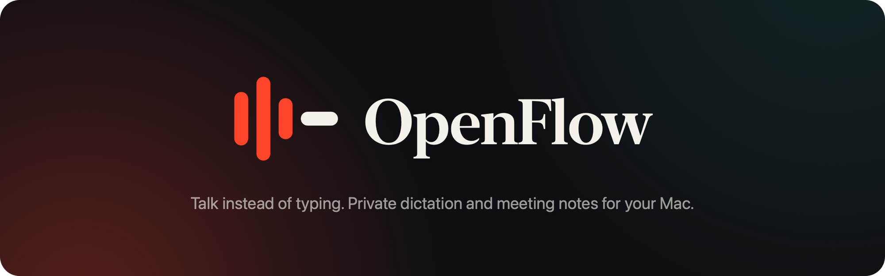
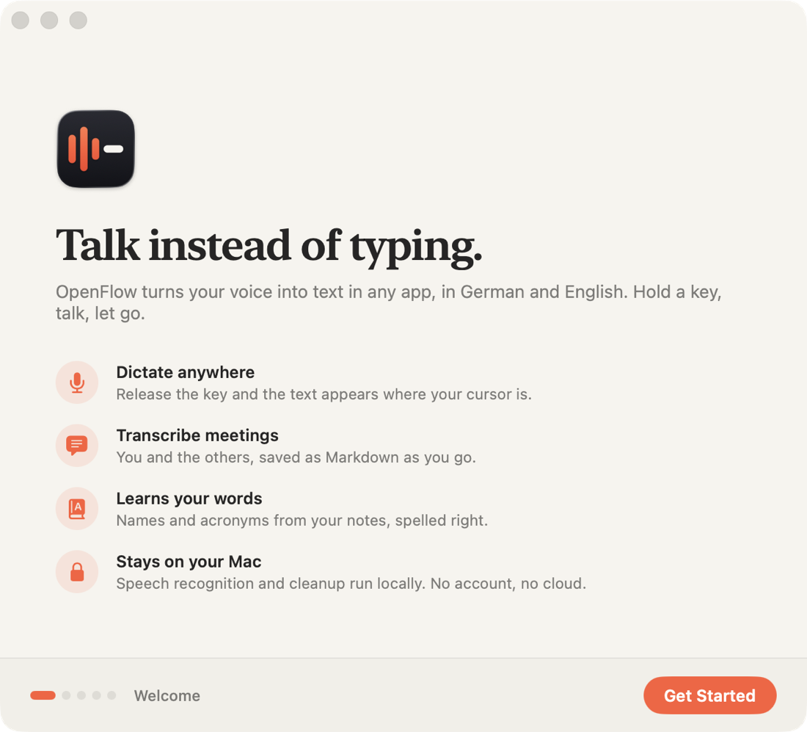
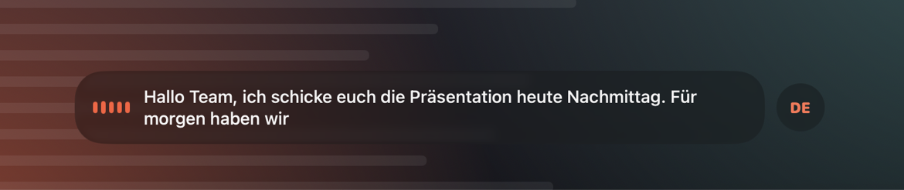
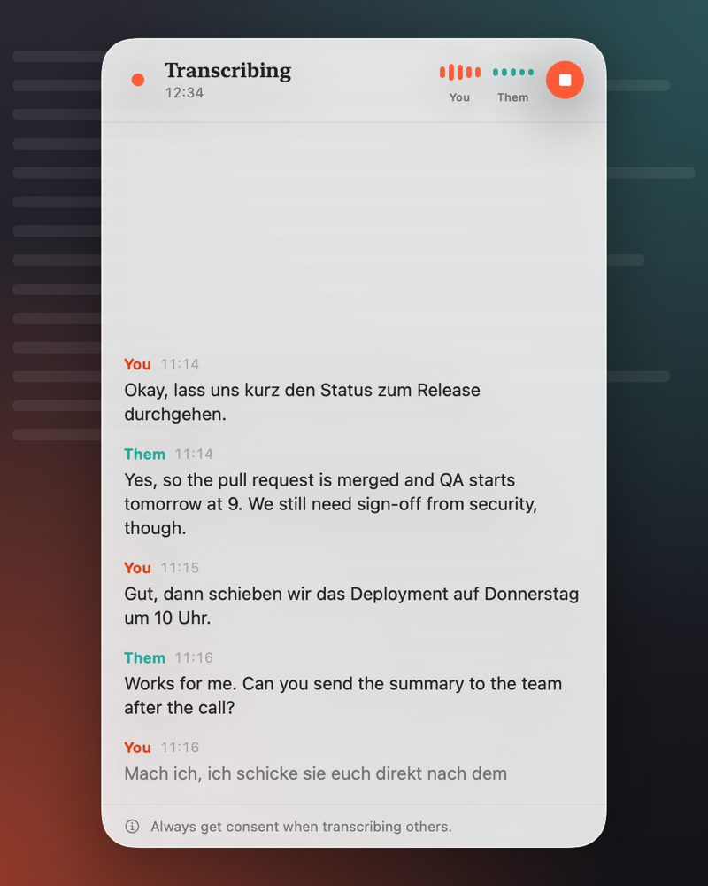
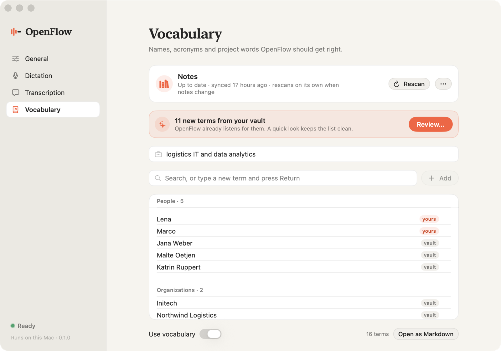
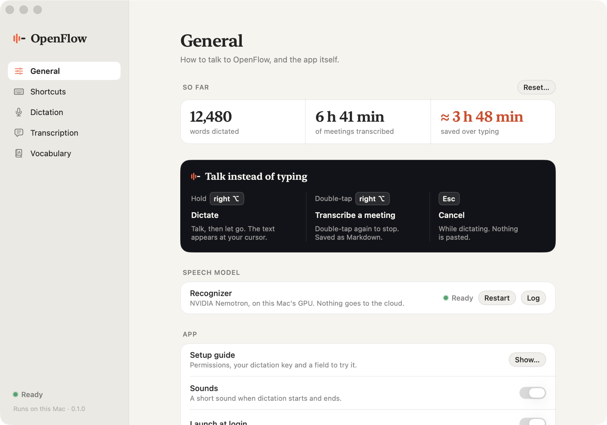

<p align="center">
  
</p>

<p align="center">
  <b>Hold a key, talk, let go: your words appear wherever you're typing.</b><br>
  Dictation and meeting transcripts for macOS, in German and English. Everything runs on your Mac.
</p>

<p align="center">
  
  
  
  
</p>

## Why OpenFlow
- **Works in every app.** Slack, mail, your browser, an AI chat, a code editor: wherever the cursor is.
- **You see it as you speak.** A small glass HUD at the bottom of the screen shows the words live, and
  the text is pasted the moment you let go.
- **Private by design.** Speech recognition (NVIDIA Nemotron) and cleanup (Gemma) run on your Mac's
  GPU. No account, no cloud, no audio stored.
- **German and English, mixed.** The language is detected each time you speak, so "Das Meeting ist
  um zehn, can you send the deck?" just works.
- **Clean text.** "Äh", "ähm" and "um" disappear, lists become `1.` `2.` `3.` while you speak, and
  "new paragraph" does what it says. Your clipboard is left as it was.
- **It learns your words.** Colleagues' names, acronyms and project names from your Obsidian vault or
  a list you keep, so they come out spelled right.
- **Meeting transcripts.** A side panel writes down you and the other side of a call, saved as
  Markdown while it runs.

## Get started
You need a Mac with Apple Silicon, macOS 15 or later (macOS 26 for the Liquid Glass look), about
8 GB of free disk space, and two developer tools:
```bash
xcode-select --install      # Swift, if you don't have Xcode
brew install uv             # Python package manager (https://docs.astral.sh/uv/)
```
Then, in a clone of this repository:
```bash
scripts/install.sh
```
It sets up everything, downloads the speech and cleanup models once (about 5.5 GB), builds
`build/OpenFlow.app` and opens it. To update later, `git pull` and run it again; it skips whatever
is already done, and macOS keeps your permissions.



On first launch a **setup guide** walks you through it:
1. **Permissions**, one at a time, each with what it's for. Microphone to hear you, Accessibility
   to paste, Input Monitoring for the shortcut. System Audio is optional, for meeting
   transcripts. Each one turns green once you allow it.
2. **Your dictation key**: right ⌥ unless you pick another.
3. **Try it** in a text field right there.

You can open the guide again any time: Settings → General → Setup guide.

<br clear="right">

## Everyday use
### Dictate
<p align="center">
  
</p>

**Hold right ⌥**, talk, let go. The text appears where your cursor is.
- **Esc** while holding cancels; nothing is pasted.
- Pressing another key with ⌥ (like ⌥L for @) still types the character, as it always did.
- **Hands-free:** start it from the menu bar (or give it a shortcut) and talk without holding a key;
  tap the dictation key to finish.
- **Pasted into the wrong place?** Menu bar → Paste Last Dictation, or pick an older one from
  Recent Dictations.
- Say "erstens … zweitens …" or "first … second …" for a numbered list, "neue Zeile" / "new line"
  and "neuer Absatz" / "new paragraph" for layout.

### Transcribe a meeting


**Double-tap right ⌥** to start, double-tap again to stop.
- The panel on the right edge of the screen shows **You** (your microphone) and **Them** (whatever
  your Mac plays: the call).
- Each line appears dimmed while it's being recognized, then settles into clean text.
- The transcript is saved as you go, as Markdown in `~/Documents/OpenFlow/Transcripts` (you can
  change the folder). Audio is never stored.
- On speakers instead of headphones, OpenFlow removes the call's audio from your microphone, so the
  others don't show up twice.
- The panel never takes focus from your meeting app; drag its edge to make it wider.

**Always get consent before you transcribe other people.**

<br clear="right">

### Teach it your words
<p align="center">
  
</p>

Open **Vocabulary** from the menu bar.
- **Connect your Obsidian vault** (or any folder of Markdown notes) once. OpenFlow reads your notes
  and picks out the names, organizations, products, acronyms and jargon in them.
- **It stays up to date on its own:** when notes change, it rescans quietly while you're not
  dictating. New terms wait for a quick review: untick what doesn't belong.
- **Add your own:** type a word and press Return. Remove a term, and a vault scan won't bring it back.
- **Or edit the list as a file:** it's plain Markdown in `~/Documents/OpenFlow/Vocabulary.md`, with
  room for how a word tends to be misheard:
  ```markdown
  Domain: logistics IT and data analytics

  ## Terms
  - ACME
  - pull request (heard as: pool request)

  ## People
  - Lena
  ```
Your vault is only ever read, never changed, and nothing leaves your Mac. In our benchmark
(synthesized German and English speech) such terms came out right 57 % of the time instead of 36 %,
with ordinary sentences unaffected.

### Make it yours
<p align="center">
  
</p>

**Settings…** in the menu bar (⌘,) opens the OpenFlow window:
- **General:** your shortcuts (dictation key, transcription, hands-free, cancel), sounds, launch at
  login.
- **Dictation:** language (automatic, Deutsch or English) and microphone. "Automatic" prefers the
  built-in mic over a Bluetooth headset, which would otherwise switch to low-quality call audio.
- **Transcription:** the transcripts folder and echo removal for speakers.

## Questions
**The shortcut does nothing.** Allow Accessibility and Input Monitoring (the setup guide shows which
one is missing), then restart OpenFlow: macOS applies these two only to a fresh start.

**"Them" stays silent in a call.** Allow System Settings → Privacy & Security → Screen & System
Audio Recording → OpenFlow (System Audio Recording Only). Until then macOS hands OpenFlow silence.

**I use the 🌐 key for dictation.** Set System Settings → Keyboard → "Press 🌐 key to" → "Do
Nothing", or macOS opens its emoji picker as well.

**The first word gets cut off.** Turn on "Keep the mic ready for 30 s" (Settings → Dictation).
Dictations in quick succession then start instantly; the orange mic dot stays on a little longer.

**Where are the logs?** `~/Library/Logs/OpenFlow-asr.log`, or Settings → General → Log.

**Does anything go online?** Only the one-time model download during install. After that OpenFlow
runs offline.

## For developers
How it works, the benchmarks, every command and the design system:
[docs/DEVELOPMENT.md](docs/DEVELOPMENT.md).

## Model licenses
The models are downloaded from Hugging Face during install and are not part of this repository:
[Nemotron 3.5 ASR Streaming 0.6B](https://huggingface.co/nvidia/nemotron-3.5-asr-streaming-0.6b) by
NVIDIA under the OpenMDW-1.1 license, and
[Gemma 4 E2B](https://huggingface.co/mlx-community/gemma-4-e2b-it-4bit) by Google; see the model
pages for their terms.
